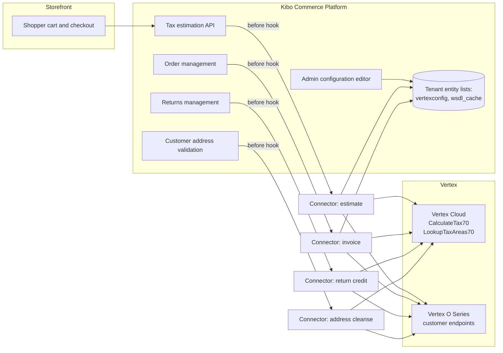
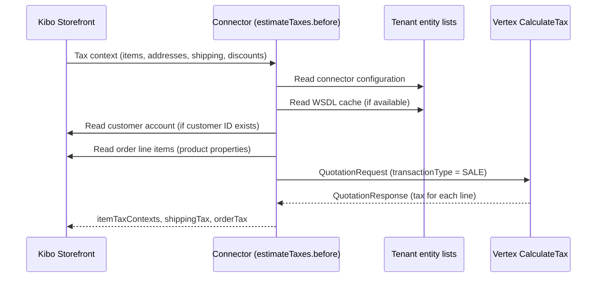
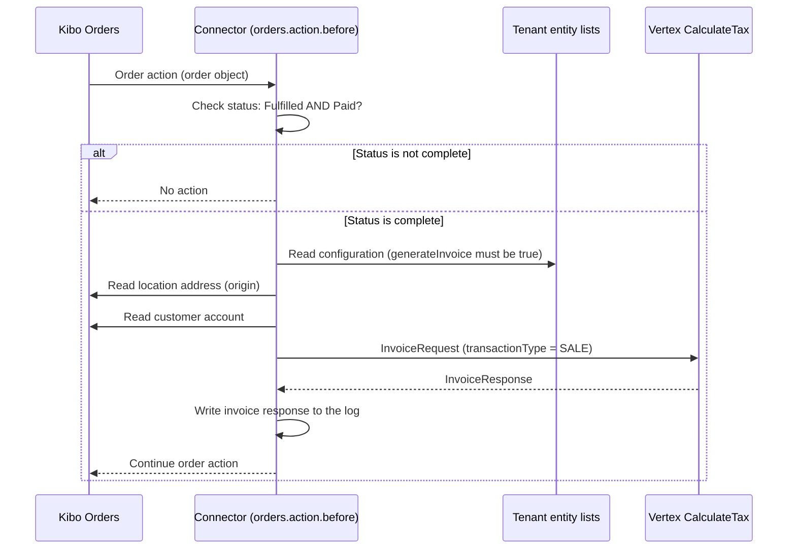
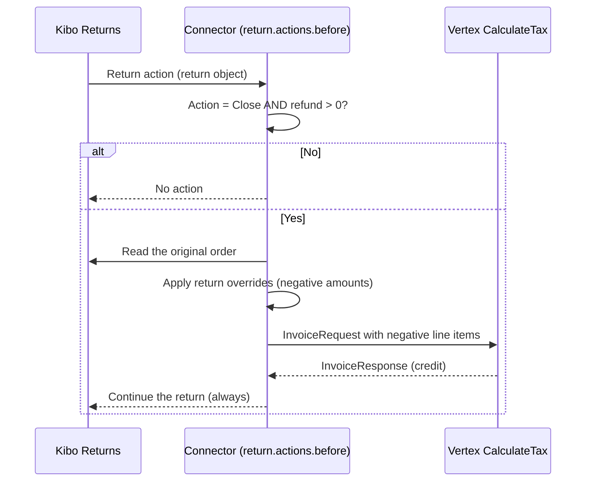
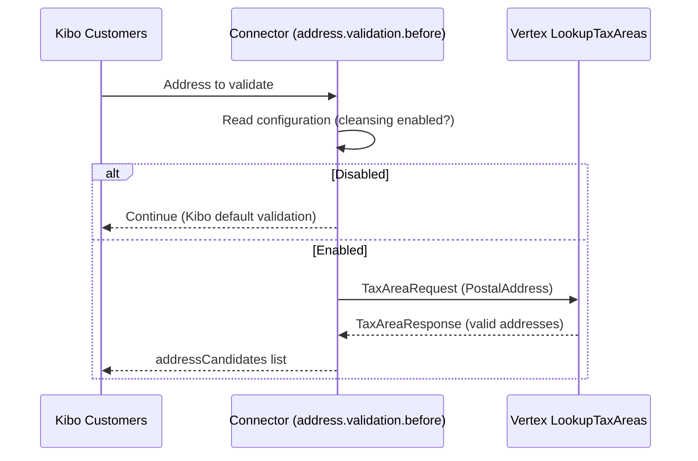
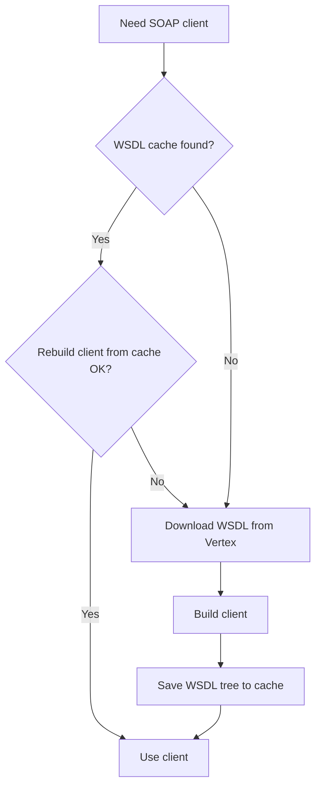
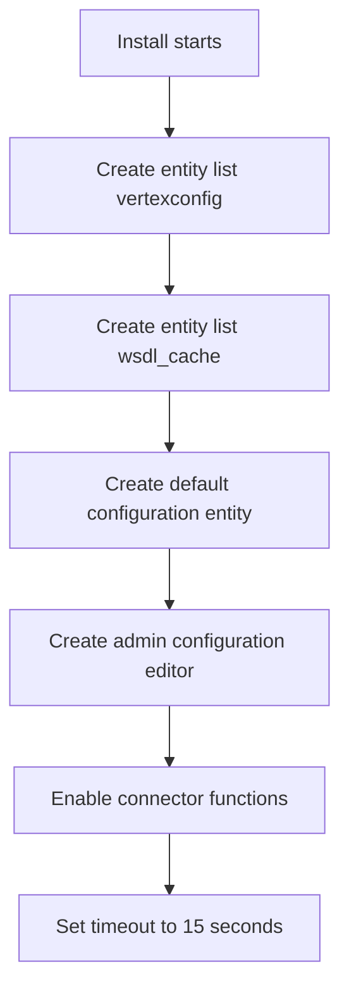

# Vertex Tax Connector — Functional Guide

## 1. Introduction

### 1.1 Purpose

This guide describes the functions of the Vertex Tax Connector for Kibo Commerce.
The guide tells you which features the connector supports.

### 1.2 Audience

This guide is for external users. Examples: system integrators, administrators, and support engineers.

### 1.3 Scope

This guide describes the functions that are available in the installed connector.
This guide does not describe the Vertex tax engine. Refer to the Vertex documentation for the tax engine.

### 1.4 Definitions

| Term | Definition |
|---|---|
| Connector | This Kibo application. It connects Kibo Commerce to Vertex. |
| Kibo | The Kibo Commerce platform. |
| Vertex | The external tax service. Two types are supported: Vertex Cloud and Vertex O Series. |
| Tenant | One Kibo customer account. |
| Estimate | A tax calculation for a cart or an order. Vertex does not record an estimate. |
| Invoice | A tax calculation that Vertex records in the Vertex tax journal. |
| Entity list | A data table in the Kibo tenant. The connector uses entity lists for configuration and cache. |

### 1.5 Diagram files

Each section has a Mermaid diagram. Rendered JPEG diagrams are in [diagrams/](diagrams/).

| File | Content |
|---|---|
| [01-system-context.jpeg](diagrams/01-system-context.jpeg) | System overview |
| [02-tax-estimate.jpeg](diagrams/02-tax-estimate.jpeg) | Storefront tax estimation sequence |
| [03-invoice-commit.jpeg](diagrams/03-invoice-commit.jpeg) | Invoice creation sequence |
| [04-return-credit.jpeg](diagrams/04-return-credit.jpeg) | Return credit sequence |
| [05-address-validation.jpeg](diagrams/05-address-validation.jpeg) | Address cleansing sequence |
| [06-wsdl-cache.jpeg](diagrams/06-wsdl-cache.jpeg) | WSDL cache logic |
| [07-installation.jpeg](diagrams/07-installation.jpeg) | Installation steps |

## 2. System Overview

The connector is a Kibo ArcJs application. It runs custom functions at defined points in the Kibo order flow.
Each function builds a SOAP request and sends it to Vertex. The function then processes the Vertex response.

### 2.1 Connector functions

The connector installs these custom functions:

| # | Kibo action | Function | Active |
|---|---|---|---|
| 1 | `http.commerce.catalog.storefront.tax.estimateTaxes.before` | Calculates tax for carts and orders. | Yes |
| 2 | `http.commerce.catalog.storefront.tax.estimateTaxes.after` | Logs the response only. | No function |
| 3 | `embedded.commerce.orders.action.before` | Creates the Vertex invoice when the order is complete. | Yes |
| 4 | `embedded.commerce.orders.action.after` | Logs the order only. | No function |
| 5 | `embedded.commerce.return.actions.before` | Creates a negative invoice for a closed return. | Yes |
| 6 | `http.commerce.customer.address.validation.before` | Validates addresses with Vertex. | Optional |
| 7 | `http.commerce.customer.address.validation.after` | Logs the response only. | No function |
| 8 | `embedded.platform.applications.install` | Installs and configures the connector. | Yes |

NOTE: Functions 2, 4, and 7 write log data only. They do not change data.

## 3. Feature: Storefront Tax Estimation

### 3.1 When it runs

Kibo calls the estimate function before the standard Kibo tax calculation.
This occurs in the cart, in the checkout, and when an order changes.

### 3.2 What it does

The function sends this data to Vertex:

- Seller origin address from the Kibo tax context.
- Customer destination address from the Kibo tax context.
- Billing address as the administrative origin, when it is available.
- One line item for each product. Quantity and extended price are included.
- One line item for shipping. The shipping method code is the product code.
- Item discounts, order discounts, and shipping discounts. The coupon code is the discount code.
- The currency code. The default is USD.
- The document date. The connector uses the original order date or the order date.
- The customer exemption certificate number, when the order is tax exempt.
- The customer code and customer class, when they are configured. See section 7.
- The product class for each line, when it is configured. See section 7.
- Flexible fields, when they are configured. See section 8.
- The company code, seller division, and seller department from the configuration.

### 3.3 What it returns

The function maps the Vertex response to the Kibo tax response:

| Vertex value | Kibo value |
|---|---|
| TotalTax of each product line | Tax of the item in `itemTaxContexts` |
| TotalTax of a child shipping line | Shipping tax of the item |
| TotalTax of the last line (order shipping) | `shippingTax` of the order |
| Sum of all item taxes | `orderTax` |

NOTE: The handling fee tax is always 0. The connector does not calculate tax for handling fees.

### 3.4 Errors

- If Vertex returns "no tax areas", the function returns this message: "Taxes could not be calculated for the given addresses, please verify addresses and try again."
- For all other errors, the function returns this message: "One or more errors occurred".
- An error stops the tax calculation. Kibo shows the error to the shopper.

## 4. Feature: Invoice Creation (Tax Commit)

### 4.1 When it runs

The invoice function runs before each Kibo order action.
The function continues only when these two conditions are true:

- The fulfillment status of the order is **Fulfilled**.
- The payment status of the order is **Paid**.

### 4.2 What it does

The function sends an `InvoiceRequest` to Vertex. Vertex records the transaction in the tax journal.
The document number is the Kibo order number. The transaction ID is the Kibo order ID.

Additional invoice data:

- Each line item can have its own origin address. The connector reads the address from the fulfillment location of the item.
- For an in-store pickup item, the destination is the pickup location address.
- The seller address in the configuration is the administrative origin.

NOTE: The connector writes the invoice response to the log. It does not write the invoice tax values back to the order.

### 4.3 Configuration switch

The configuration field **Generate Invoice** controls this feature.
The default value is `true`. Set the value to `false` to disable invoice creation.

### 4.4 Errors

If the invoice request fails, the function returns an error to Kibo. The order action fails.

## 5. Feature: Return Credit (Negative Invoice)

### 5.1 When it runs

The return function runs before each Kibo return action.
The function continues only when these two conditions are true:

- The return action name is **Close**.
- The refund amount is larger than 0.

### 5.2 What it does

The function builds a copy of the original order. It then applies the return data:

- It keeps only the returned items.
- It sets negative prices and quantities that agree with the refund.
- It adjusts item discounts, order discounts, and shipping discounts by the return ratio.
- It distributes order-level shipping refunds to the items.

Vertex records a negative invoice. The negative invoice cancels the tax of the returned items.

WARNING: Return errors do not stop the return process. The connector writes the error to the log and continues. Check the logs to find failed return credits.

## 6. Feature: Address Cleansing (Address Validation)

### 6.1 When it runs

The address function runs before the Kibo customer address validation.
The function runs only when **Address Cleansing Enabled** is `true` in the configuration.

### 6.2 What it does

The function sends the address to the Vertex tax area lookup service.
Vertex returns zero or more valid addresses. The function returns these addresses as candidates.
Each candidate has the flag `isValidated = true`.

NOTE: The configuration has an **Address Cleansing Auto Accept** field. The current version of the connector stores this value but does not use it. The function always returns the candidate list.

### 6.3 Errors

- If Vertex finds no valid address, the function returns this message: "Address could not be validated, please check your address and try again".
- If the configuration is not available, the function continues without validation.

## 7. Feature: Customer and Product Tax Mappings

The connector reads these Kibo attributes to classify customers and products:

| Data | Kibo source | Vertex field |
|---|---|---|
| Customer code | Customer attribute `tenant~vertex-customer-code` | CustomerCode |
| Customer class | Customer attribute `tenant~vertex-customer-class` | CustomerCode classCode |
| Product class | Product property `tenant~vertex-product-class` | Product productClass |
| Product class (alternative) | Product property `tenant~tax-code` | Product productClass |
| Tax exemption | Order tax context exempt ID / order customer tax ID | ExemptionCertificate |

If no product property matches, the connector uses the product type as the product class.

## 8. Feature: Flexible Fields (Flex Fields)

Flex fields send custom data to Vertex with each line item.
Vertex can use flex fields for tax rules and for reports.

### 8.1 Limits

| Flex field type | Maximum number | Value rule |
|---|---|---|
| Code (string) | 25 | Maximum 40 characters. Longer values are cut. |
| Numeric | 10 | Numeric value. |
| Date | 5 | Must be a valid date. Invalid dates are skipped. |

### 8.2 Sources

Each flex field maps to one source field. These sources are available:

| Source | Examples |
|---|---|
| Billing Info | payment type, credit type |
| Customer Attributes | any tenant customer attribute (FQN) |
| Fulfillment Info | shipping method code, commercial destination flag |
| Order Attributes | any tenant order attribute (FQN) |
| Order Data | channel code, currency code, external ID, and more |
| Product Attributes | any product property (FQN) |

NOTE: If the source value is empty, the connector skips the flex field.

## 9. Feature: WSDL Cache

The SOAP client needs the Vertex WSDL definitions. The WSDL download is slow.
The connector stores the WSDL definitions in the tenant entity list `wsdl_cache`.
The next request reads the cache and builds the client locally.

NOTE: If the cache save fails, the connector continues. The cache failure does not stop tax calculation.

## 10. Installation

The install function runs when you install or update the application in a tenant.

Details:

- The installer does not delete a configuration that exists. It skips existing entities.
- The installer does not replace an entity list that is in use.
- The installer sets a timeout of 15 seconds for the estimate, order, and return functions.

## 11. Configuration Reference

The administrator edits the configuration in the Kibo admin. The installer adds the "Vertex" configuration editor.

| Field | Description | Default |
|---|---|---|
| Vertex Connection | `vertexCloud` or `vertexOSeries` | `vertexOSeries` |
| Auth Type | `trustedId` or `username` | `trustedId` |
| Username / Password | O Series credentials | empty |
| Trusted ID Cloud | Vertex Cloud trusted ID | empty |
| Trusted ID OSeries | O Series trusted ID | empty |
| Company Code | Vertex Cloud company code | `100` |
| Company Code OSeries | O Series company code | `100` |
| Seller Division | Optional Vertex seller division | empty |
| Seller Department | Optional Vertex seller department | empty |
| Address Line 1/2, City, State, ZIP, Country | Seller administrative address | Country = `UNITED STATES` |
| Generate Invoice | Enable invoice creation | `true` |
| Calculate Tax WSDL | O Series tax endpoint WSDL URL | empty |
| Address Cleansing Enabled | Enable address validation | `false` |
| Address Cleansing Auto Accept | Stored, not used | `false` |
| Address Cleansing WSDL | O Series address endpoint WSDL URL | empty |
| Flex Fields | Mappings for code, numeric, and date fields | empty |

Connection types:

| Setting | Vertex Cloud | Vertex O Series |
|---|---|---|
| Tax WSDL URL | Fixed (Vertex Cloud URL) | You supply the URL |
| Address WSDL URL | Fixed (Vertex Cloud URL) | You supply the URL |
| Authentication | Trusted ID | Username and password, or Trusted ID |

## 12. Feature Support Matrix

| Feature | Supported |
|---|---|
| Tax estimate for cart, checkout, and order | Yes |
| Item, order, and shipping discounts | Yes |
| Line-item shipping and order-level shipping | Yes |
| Tax exemption certificate | Yes |
| Customer code and customer class | Yes |
| Product class from product properties | Yes |
| Currency code | Yes |
| Invoice commit when order is Fulfilled and Paid | Yes |
| Origin address per fulfillment location | Yes (invoice) |
| In-store pickup destination | Yes (invoice) |
| Return credit on return Close with refund | Yes |
| Partial return amount proration | Yes |
| Address validation | Yes (optional) |
| Vertex Cloud connection | Yes |
| Vertex O Series connection | Yes |
| Flex fields (25 code, 10 numeric, 5 date) | Yes |
| Handling fee tax | No (always 0) |
| Write invoice tax values back to the order | No (log only) |
| Address auto-accept | No (field is stored, not used) |
| Duty calculation | No |

## 13. Logging and Security

- The connector writes all SOAP requests and responses to the function log.
- The connector masks the username, password, and trusted ID in the log.
- The connector keeps an in-memory copy of the configuration and of order data for one execution. This improves performance.

## 14. Troubleshooting

| Symptom | Possible cause | Action |
|---|---|---|
| "Taxes could not be calculated for the given addresses" | Vertex cannot find a tax area | Verify the destination address and the origin address. |
| "One or more errors occurred" | Vertex request failed | Read the function log. Verify credentials and the WSDL URL. |
| No invoice in Vertex | Order status is not Fulfilled and Paid, or Generate Invoice is `false` | Check the order status and the configuration. |
| No return credit in Vertex | Return was not closed, or refund amount is 0, or an error occurred | Check the return status. Read the function log. |
| Slow first tax request | WSDL cache is empty | The first request downloads the WSDL. Later requests use the cache. |
| Address validation does not run | Address Cleansing Enabled is `false` | Set the field to `true` in the configuration. |
